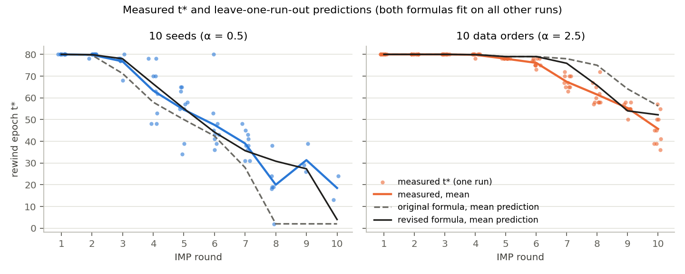
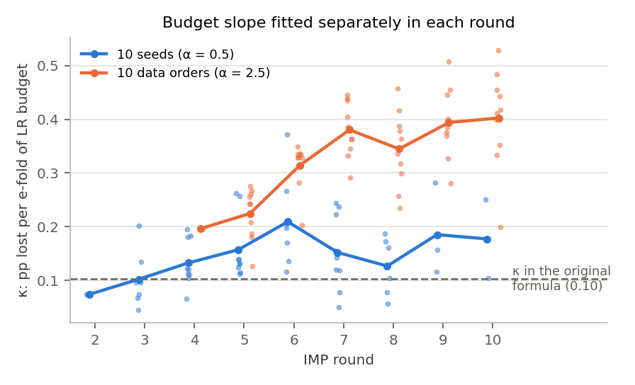
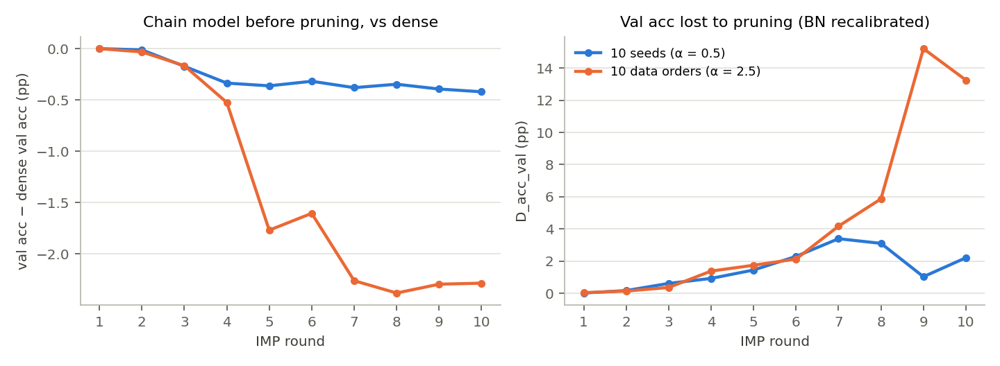
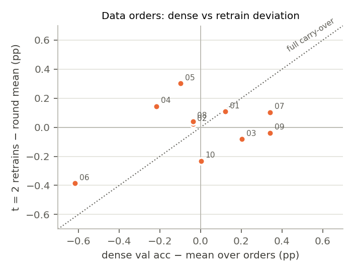

# Part 3: the data-order experiment, and what it does to the t* formula

*Follows [Part 1](https://github.com/navya448/Iterative_Model_Compression/blob/eval-10seed/imp_rewind/repeated_experiments/eval_10seed/reports/01_ten_seed_evaluation.md) and [Part 2](https://github.com/navya448/Iterative_Model_Compression/blob/eval-10seed/imp_rewind/repeated_experiments/eval_10seed/reports/02_redefined_tstar.md) (branch `eval-10seed`). Every number below comes from `python evaluate.py` and is also in [`results/numbers.txt`](results/numbers.txt). Raw run folders were only read, never changed.*

## Data

- **Experiment:** `data_order_experiments/runs/20261102_165000`. It has 10 data orders, with the same init and the same per-image augmentation (seed 1), α (tol) = 2.5, T = 80 and 10 rounds. All 10 orders finished all 10 rounds, and every round recovered: 100 rounds, 401 rewind trials.
- **Earlier folders:** `20261102_163045` … `164921` are aborted launches or 2-epoch smoke tests. Their logs end with `--t_min must be less than dense training epochs`. They are not used.
- **Comparison data:** the 10-seed runs used to build the formula, which are the 2 discovery runs plus repeated seeds 3–10, at α = 0.5. Repeated seeds 1 and 2 are excluded, as in Part 1. This gives 84 rounds and 374 trials. Refitting the original formula on them reproduces Part 1: a0 = 0.635, a1 = 0.537, κ = 0.102.
- **Monotonicity:** no data-order round has a later rewind that recovered after an earlier one failed, so the binary search's monotonicity assumption holds in all 100 rounds.

## Summary

**What data order alone does**

- **It accounts for all of the run-to-run scatter of a single retrain.** At the same round, a t = 2 retrain varies by SD 0.28 pp across data orders. Across full seeds it varies by 0.26 pp. Changing the init adds nothing measurable on top of data order.
- **t\* spread under data order alone is about half the seed spread.** At the same round, the SD is 3.9 epochs, or 0.47 e-folds of LR budget. For full seeds it is 8.7 epochs, or 1.07 e-folds. These sit in different parts of the schedule (α differs), so compare them in accuracy terms instead: 0.47 × κ(≈ 0.3) ≈ 0.14 pp, and 1.07 × κ(≈ 0.15) ≈ 0.16 pp. Both are smaller than the 0.28 pp single-retrain scatter. This answers Part 2's open question: most of the leftover t\* spread is retraining (data-order) noise, not a real run-to-run difference.
- **Dense val accuracy is noisy, and the noise is not carried into retraining.**
  - Dense val acc varies more across data orders (SD 0.29 pp) than across seeds (0.16 pp; F = 3.4, p = 0.04).
  - The same models' test acc varies by only 0.16 pp, so most of that val spread is noise from the 5k-image val split.
  - An order's dense val deviation does not predict its retrain deviation (Spearman −0.09, p = 0.80; Fig. 4).
  - Measuring every round against each run's own dense val acc therefore adds about 0.3 pp of noise to the target. This supports Part 2's switch to a common target.

**What happens to the formula**

- **The original formula fails at α = 2.5.**
  - **t\* prediction:** fitted on the 10 seeds, it predicts t̂ = 79 in every round that needs retraining. Measured t\* falls from 78 (round 5) to 46 (round 10). MAE on those rounds is 14.8 epochs, with 61% of predictions too late.
  - **Accuracy prediction:** it over-predicts recovered accuracy by 1.06 pp on average. The error grows with the rewind epoch: −0.49 pp for t < 40, −1.06 for 40–59, −1.29 for t ≥ 60.
- **The cause is not the shape of the law.** Within a round, recovered accuracy is still linear in the budget clock ln(B(t_min)/B(t)). A quadratic term lowers the residual SD only from 0.317 to 0.305. What changes are the two quantities the original formula treats as fixed:
  1. **κ about doubles.** The per-round slope is 0.20–0.40 pp per e-fold under data order, against 0.07–0.21 for the 10 seeds and 0.10 in the formula (Fig. 2).
  2. **The chain degrades.** With α = 2.5, each round continues from a model rewound late (t\* ≈ 60–78), so it was barely retrained.
     - By round 7, the parent model is 2.3 pp below dense; in the 10-seed chains it is 0.4 pp below (Fig. 3).
     - Pruning that model does far more damage: D_acc reaches 15 pp at round 9, against 1–3 pp.
     - Capacity at t = 2 is lower than at the same sparsity in the 10-seed runs (round 10: −1.42 against −0.47 pp).
- **The revised formula adds two terms, both measured right after pruning:**

  ```
  A(t) − A_dense = a0 − a1·ln(1/d) + a2·(before_val_acc − A_dense)
                   − (k0 + k1·ln(1 + D_acc)) · ln(B(t_min)/B(t))
  ```

  | | value | 95% CI (run bootstrap) | fit on 10 seeds only | fit on data orders only |
  |---|---|---|---|---|
  | a0 | 1.181 | [0.866, 1.641] | 0.691 | 2.197 |
  | a1 (ln 1/d) | 0.695 | [0.515, 0.961] | 0.426 | 1.326 |
  | a2 (parent deficit) | 0.305 | [0.194, 0.402] | 0.564 | 0.204 |
  | k0 | 0.095 | [0.062, 0.148] | 0.077 | 0.223 |
  | k1 (ln(1 + D_acc)) | 0.108 | [0.086, 0.127] | 0.034 | 0.058 |

  - **Capacity:** each pp the parent is below dense lowers capacity by about 0.3 pp.
  - **κ:** it is 0.17 after a 1 pp pruning hit, 0.29 after 5 pp and 0.39 after 15 pp.
  - **t\* rule:** unchanged, t̂ = B⁻¹(B(t_min)·exp(−S/κ)), now with this round's capacity and κ.

**Held-out comparison** (leave one run out over all 20 runs; each prediction comes from a fit on the other 19):

| method | MAE, α = 0.5 runs | MAE, α = 2.5 runs | MAE on rounds needing retraining (0.5 / 2.5) | too late (0.5 / 2.5) |
|---|---|---|---|---|
| Original formula | 8.28 | 4.77 | 11.4 / 7.8 | 9% / 60% |
| Original formula, margin 0.1 | 9.84 | 3.95 | 13.6 / 6.5 | 8% / 59% |
| **Revised formula** | **5.28** | **2.93** | **7.3 / 4.8** | 29% / 48% |
| Revised formula, margin 0.1 | 6.18 | 2.73 | 8.5 / 4.5 | 21% / 47% |
| Round median + check, both datasets | 15.49 | 3.72 | 21.4 / 6.1 | 61% / 7% |
| Sparsity line + check, both datasets | 9.96 | 7.72 | 13.8 / 12.7 | 59% / 4% |
| Round median + check, same α only | 4.70 | 1.66 | 6.5 / 2.7 | 34% / 19% |
| Sparsity line + check, same α only | 5.05 | 2.22 | 7.0 / 3.6 | 28% / 26% |



*Fig. 1. Measured t\* (dots: one run; thick line: mean) and the mean leave-one-run-out prediction of the original (dashed) and revised (black) formula.*

- **The revised formula is the only predictor that works at both α values with one fit.**
  - The epoch-based baselines cannot move across α. Trained on both datasets, the round median is 15.5 epochs off on the α = 0.5 runs.
  - Baselines fitted separately for each α are still more accurate (4.7 / 1.7 against 5.3 / 2.9). They can only exist after a full search has been run at that α, though.
  - This is the first evidence for the formula's main argument from Part 1, that it transfers across settings and epoch rules do not.
- **On the old data alone, the revised formula costs nothing.** Trained and tested only on the 10-seed runs (leave one run out), its MAE is 5.43 against 6.59 for the original at margin 0. At margin 0.1 it is 6.26 against 6.11, a tie.

**Not fixed**

- **κ still depends on the setting.** After the revised terms, a data-order × clock term is still +0.081 pp per e-fold [0.053, 0.114]; with the original formula it is +0.096. The two new terms explain only about 15% of the κ gap.
  - Fitted separately, the two datasets give k0 = 0.077 and k0 = 0.223, which is the same gap.
  - This is why the revised formula is still too late on 48% of data-order rounds.
- **Three things changed at once between the two experiments, so the cause of the κ gap cannot be identified:**
  1. α (2.5 instead of 0.5), and with it how degraded the chain is;
  2. fixed augmentation. With `aug_seed` set, a retrain from epoch t replays exactly the crops and flips the dense model saw in epochs t..T−1 (`common.CIFARData.fixed_aug_params`), while the 10-seed retrains draw new ones. Replayed images may be worth less per epoch, which would make κ larger;
  3. the data order itself, which the noise numbers above show only adds scatter, not a shift.

**Side observation, not part of the final formula: κ measured from one short late rewind**

Run one short late rewind first: the earliest trial with t ≥ 66, about 10.5 epochs, or 13% of a t_min retrain. Set this round's κ = (predicted capacity − probe result) / probe clock, keep the predicted capacity, and solve for t̂ as before. On the rounds whose search happened to include such a trial:

| | rounds | MAE, κ from formula | MAE, κ from probe | too late, formula / probe |
|---|---|---|---|---|
| 10 seeds | 18 | 4.33 | 3.17 | 39% / 50% |
| data orders | 36 | 4.14 | 2.61 | 92% / 81% |

The probe picks up most of the κ gap: median κ is 0.15 with α = 0.5 and 0.25 with α = 2.5. It is not used in the final formula, because only rounds where the binary search happened to reach a late t could be checked, which leaves out rounds with early t\*.



*Fig. 2. κ fitted separately in each round with at least 3 trials. The dashed line is the single κ of the original formula.*



*Fig. 3. Left: the chain model before pruning, relative to dense. Right: val accuracy lost to pruning. With α = 2.5 the chain continues from barely retrained models, and pruning them does far more damage.*



*Fig. 4. Each data order's dense val deviation against the mean deviation of its t = 2 retrains. Full carry-over would put the points on the dotted line. Only order 06 sits near it.*

## Final formula

```
A(t) − A_dense = 1.181 − 0.695·ln(1/d) + 0.305·(before_val_acc − A_dense)
                 − (0.095 + 0.108·ln(1 + D_acc)) · ln(B(t_min)/B(t))

t̂ = T                                   if the pruned model already meets the target
t̂ = B⁻¹( B(t_min) · exp(−S/κ) )          otherwise
     S = 1.181 − 0.695·ln(1/d) + 0.305·(before_val_acc − A_dense) + α − margin
     κ = 0.095 + 0.108·ln(1 + D_acc)
t̂ = t_min ("stop")                      if S ≤ 0
```

- d = fraction of weights kept, before_val_acc = the chain model before this round's pruning, D_acc = val accuracy lost to pruning (BN recalibrated, clipped at 0), α = the tolerance, B(t) = LR budget left after epoch t in units of the peak LR. B⁻¹ returns the latest integer t with B(t) at or above the value.
- Fitted on all 20 runs (775 rewind trials). It is `revised()` in [`formula.py`](formula.py); the original is kept as `original()`.
- Use margin 0 for the lowest error, or 0.1 pp for fewer too-late predictions on the α = 0.5 runs (21% against 29%).
- Measure against a common target rather than each run's own dense val acc (Part 2): dense val noise is about 0.3 pp and does not reach the retrains.

## Conclusions

1. **Data order alone accounts for the run-to-run scatter of retraining.** A different initialisation adds nothing measurable. The leftover t\* spread is retraining noise.
2. **The original formula does not transfer from α = 0.5 to α = 2.5.** It predicts t̂ = 79 for every round and is too late on 61% of them.
3. **The log-budget law itself holds.** Within a round, recovered accuracy stays linear in ln(B(t_min)/B(t)). What the original got wrong is that capacity and κ depend on the state of the chain.
4. **The revised formula fixes most of this.** One fit works at both α values (MAE 5.3 and 2.9 epochs, leave one run out), where epoch-based baselines trained on both fail (up to 15.5 epochs). On the original 10-seed data alone it is no worse than the original formula.
5. **κ is still partly setting-dependent** (+0.08 pp per e-fold left over at α = 2.5). Predictions for a new setting should be read with that in mind: the revised formula is still too late on about half of the α = 2.5 rounds. With margin 0.1 its average error there is 4.5 epochs.

## Limitations

- One architecture, one dataset, one LR schedule. The two datasets differ in three ways at once (see "Not fixed").
- **Too few runs to test the extra terms properly.** Leave-one-run-out over 20 runs was used for model selection as well as scoring. Twelve variants were compared during exploration; the chosen one was the best on the pooled score, which flatters it a little. Each extra term is supported by its bootstrap CI, but a fresh test set is the proper check.
- Data-order t\* rounds are mostly in the last LR phase. There, 0.05 pp of predicted accuracy is about 1 epoch, so epoch errors are large even when the accuracy model is close.
- The probe result uses only rounds whose binary search happened to try a late t (see above).
