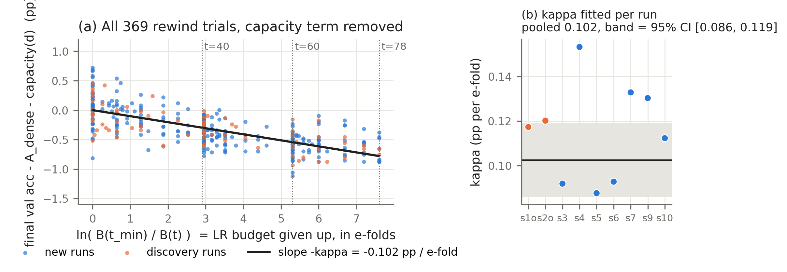
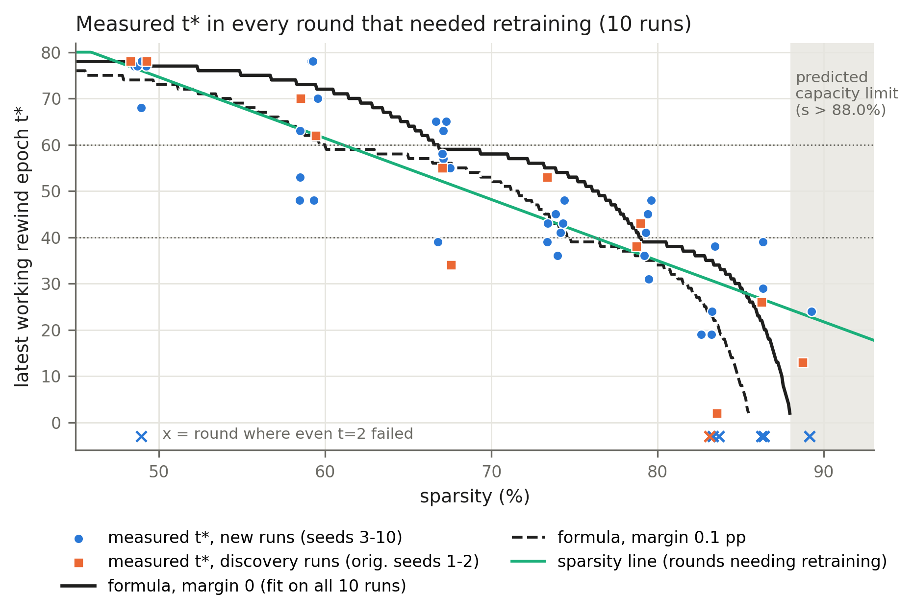
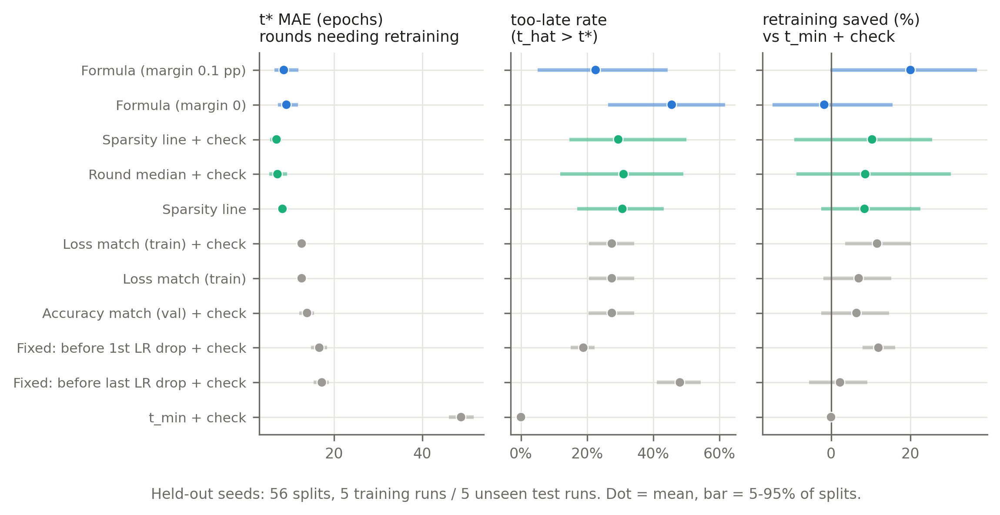
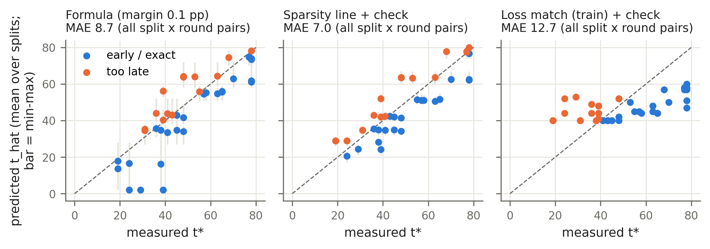
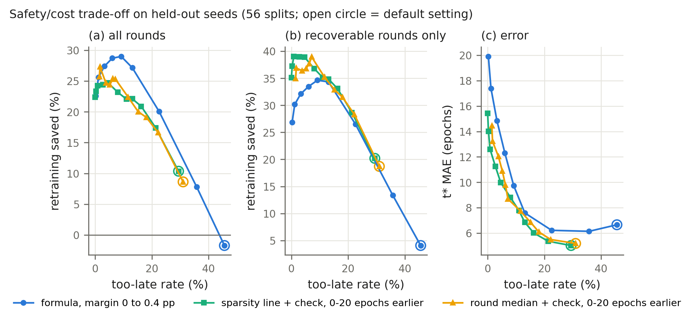
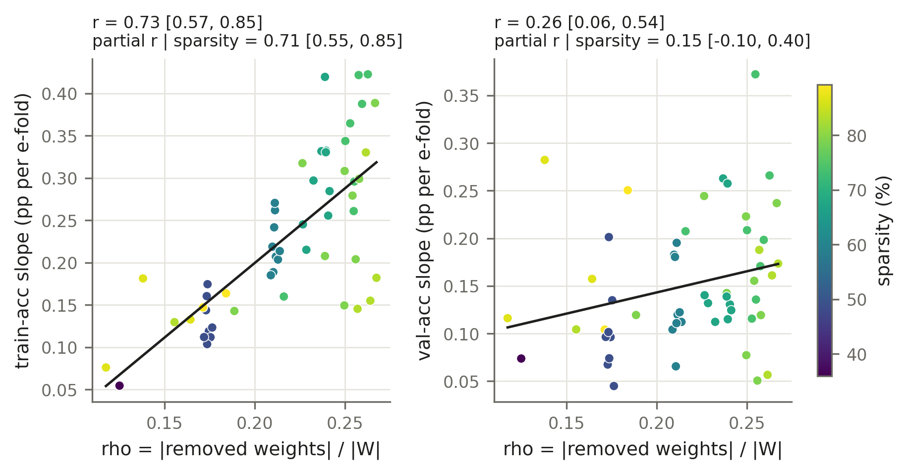
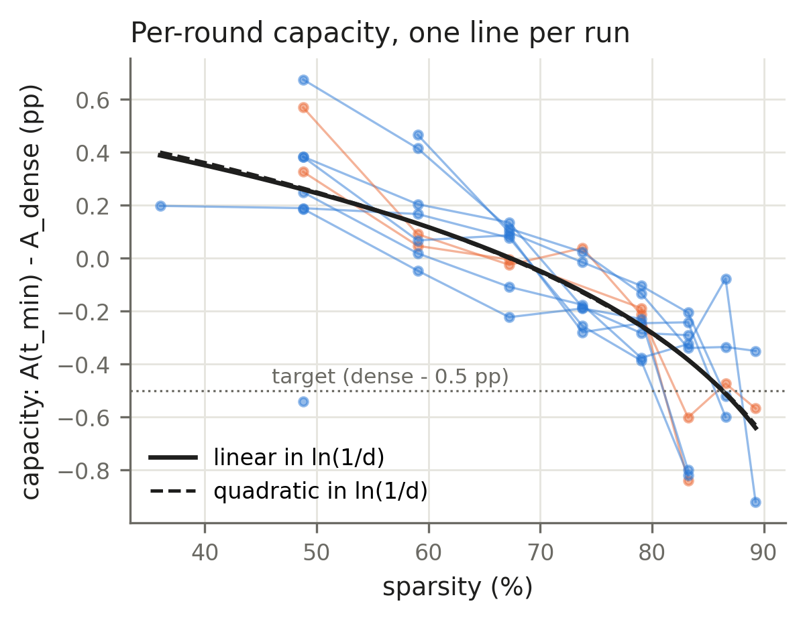

# Predicting the IMP rewind point t*: 10-seed evaluation

*Part 1 of 2. Part 2 is [02_redefined_tstar.md](02_redefined_tstar.md). Paths are relative to `imp_rewind/repeated_experiments/eval_10seed/`.*

ResNet-20, CIFAR-10 (45k/5k/10k), T = 80, LR 0.1 with ×0.1 at epochs 40 and 60, 20% global magnitude pruning per round, recovery = final val acc ≥ dense val acc − 0.5 pp, binary search for t* (resolution 2, t_min = 2).

Everything here is produced by the scripts in `eval_10seed/` (`python run_all.py`). Every number below is taken from [`results/report_tables.md`](../results/report_tables.md), which `06_report_tables.py` generates from the CSVs. Raw run folders were only read, never modified.

## Summary

**Confirmed on 8 unseen runs**

- **The learning-rate-budget law holds.** Recovered val accuracy falls by κ ≈ 0.10 pp for every e-fold of remaining LR budget given up. κ is stable across runs and splits: the 95% seed-bootstrap CI is [0.086, 0.119], and per-split fits range from 0.091 to 0.123. The accuracy model generalises: trial RMSE is 0.223 pp on training runs and 0.243 pp on test runs.
- **The formula beats every original candidate rule**, including when each rule gets the no-retraining check. Against loss-match (train) + check, MAE is 2.7 epochs lower (CI [0.9, 4.9]) and the formula wins on 6 of 7 non-tied seeds (Wilcoxon p = 0.031).
- **The no-retraining check is the largest single improvement** for every predictor. Examples: loss match (train) 12.1 → 9.2 epochs; sparsity line 6.5 → 5.0.
- **κ depends on ρ (= |removed| / |W|) in the training metrics.** The partial correlation of the train-accuracy slope with ρ, given sparsity, is 0.71 [0.55, 0.85].

**Not supported**

- **The formula is not better than simple data-driven baselines at predicting t*.** "Sparsity line + check" and "round median + check" have MAE 5.0 and 5.2 epochs; the formula has 6.2 (margin 0.1 pp) and 6.7 (margin 0). Per seed, the formula with margin 0.1 is 1.0 epoch worse than sparsity line + check (CI [−0.04, 2.1], p = 0.22). The baseline has the lower MAE in 87.5% of splits.
- **The formula's cost advantage does not come from better t* prediction.** At its default margin it saves 20% of retraining against "rewind to t_min + check", versus 10% for sparsity line + check. That gap is explained by (i) a more conservative default and (ii) the capacity-limit "stop" flag on unrecoverable rounds. Compared at equal too-late rates on recoverable rounds only, the baselines save as much or more (Fig. 7b).
- **κ(ρ) does not improve prediction of val-accuracy-based t*.** It leaves held-out RMSE unchanged and gives mixed MAE changes.
- **No alternative capacity form improves held-out RMSE.** Tried: quadratic in ln(1/d), 1/d, per-round capacity, and absolute accuracy.
- **The capacity-limit flag is unreliable.** Per 5-seed test set it catches 1.9 of 3.75 unrecoverable rounds, but also raises 2.1 false stops on rounds that did recover.

**Open / hypotheses**

- The dominant error is the seed-to-seed offset in capacity, not the functional form. Per-run fits give a0 from 0.26 to 1.26 and a1 from 0.31 to 0.83.
- Measured t* varies widely between seeds at the same round: the mean |t* − round median| is 5.6 epochs, even in-sample. The formula's possible advantage, transfer across LR schedules because it is written in LR budget rather than epochs, has not been tested.

## 1. Data and audit (`01_audit_runs.py`, [`audit/`](../audit/AUDIT.md))

12 run directories were checked with 14 checks each:

- config against the protocol;
- dense-log epochs and LR column against the schedule;
- target = dense val acc − 0.5 in config, rounds and trials;
- round 1 starts from the dense model;
- sparsity = 1 − 0.8^k;
- chain continuity;
- trial JSON vs CSV, and the recovered flags;
- the binary search replayed from recorded outcomes;
- the final model is the t* trial;
- summaries;
- curves;
- completeness;
- wrapper logs.

| run | decision | reason |
|---|---|---|
| seed1_orig, seed2_orig (`imp_rewind/runs`) | included (discovery) | all checks pass; these two runs were used to design the formula |
| repeated seed1 | **excluded** | the wrapper log shows `--epochs 2 --rounds 1` smoke runs written into the same run_dir. The full run then resumed round 1 from that smoke test: round 1 `before_val_acc` is 63.86 against a dense 91.54, and the round-1 target is 63.36. Every later mask descends from a 2-epoch model. |
| repeated seed2 | **excluded** | same issue (round 1 `before_val_acc` 55.16 against a dense 90.76) |
| seed3–seed9 | included | all checks pass |
| seed8 | included | the chain stopped at round 3 (48.8%) because the t = 2 retrain reached 90.56 against a target of 90.60, a 0.04 pp miss |
| seed10 | included, truncated | crashed in round 8 on a corrupted cached checkpoint. Rounds 1–7 are complete. Round 8 is censored (t = 2 recovered; t = 21 and t = 41 did not, so t* is in [2, 20]); its 3 finished trials are used only in the accuracy fit. Rounds 9–10 were not run. |

Root cause of the two exclusions: `repeated_experiments/README.md` tells you to run the wrapper check (`--epochs 2 --rounds 1`) with the default `runs_dir`, which is the same folder the real runs use.

The working-tree changes under seed9 differ from the commit only in line endings.

The old `repeated_experiments/analysis/` folder comes from that smoke run. It was left untouched and should not be used.

**Included data:**

| | discovery runs | new runs (seeds 3–10) | total |
|---|---|---|---|
| rounds | 18 | 64 | 82 |
| no-retrain rounds | 5 | 16 | 21 |
| searched rounds | 12 | 42 | 54 |
| unrecoverable rounds | 1 | 6 | 7 |
| rewind trials | 80 | 289 | 369 |

Verified for all 10 runs:

- **LR column:** row e of the dense log holds the LR of epoch e − 1 → e.
- **Remaining budget:** B(t) = Σ_{e=t}^{79} η(e)/η_max, with B(2) = 40.2, B(40) = 2.2, B(60) = 0.2 and B(78) = 0.02.
- **Target:** equals dense val acc − 0.5.
- **Binary search:** replaying it from the recorded outcomes reproduces every recorded t* and trial set.

## 2. Original methodology reproduced (`02_original_method.py`)

`analyze.py` was run unchanged.

**Discovery runs.** The rule scores are identical to the mid-term report; for example, loss match (train) has MAE 16.65 epochs over 17 rounds.

**On the 8 new runs as `--test_runs` (58 rounds with t*):**

| rule | MAE (epochs) | too late |
|---|---|---|
| loss match (train) | 12.16 | 16 |
| accuracy match (val) | 12.59 | 16 |
| before last LR drop | 18.31 | 28 |

Damage features add almost nothing once rounds are compared at equal sparsity. The within-round correlation with t* across seeds is −0.17 to −0.25, against a Spearman of −0.92 between t* and sparsity when all runs are pooled. This confirms the mid-term conclusion with 5× the data.

## 3. The formula (`models.py`)

A(t) − A_dense = a0 − a1·ln(1/d) − κ·ln(B(t_min)/B(t)), fitted by least squares on rewind trials.

t̂ = T if the pruned model already meets the target. Otherwise t̂ = B⁻¹(B(t_min)·exp(−S/κ)), with slack S = 0.5 + a0 − a1·ln(1/d) − margin; B⁻¹ returns the latest integer t whose B(t) is at least that value. If S ≤ 0, the formula predicts "stop" (t̂ = t_min). The closed form agrees with a brute-force search over t in 738 of 738 predictions.

| fit on | trials | a0 | a1 | κ | trial RMSE | capacity limit |
|---|---|---|---|---|---|---|
| all 10 runs | 369 | 0.634 [0.41, 0.88] | 0.535 [0.42, 0.65] | 0.1025 [0.086, 0.119] | 0.230 | 88.0% |
| discovery runs only | 80 | 0.839 | 0.676 | 0.114 | 0.216 | 86.2% |
| 8 new runs only | 289 | 0.568 | 0.487 | 0.099 | 0.231 | 88.8% |

The CIs are 95% seed-cluster bootstrap. The discovery runs over-estimated capacity, which is why margin 0 is biased late on the new runs (mean signed error +2.6 epochs).



*Fig. 2. (a) All 369 rewind trials with the capacity term removed: recovered accuracy falls linearly in the log of the LR budget given up. (b) κ fitted separately on each run, with the pooled value and its 95% CI.*



*Fig. 1. Measured t\* in every round that needed retraining, with the formula (fit on all 10 runs) and the sparsity line.*

## 4. Held-out evaluation (`03_formula_eval.py`)

**Protocol.** Every split uses 5 test runs drawn from the 8 new runs: C(8,5) = 56 splits. The 5 training runs are the other 3 new runs plus the 2 discovery runs, so test runs never influenced the formula's form, its margin, or any fitted parameter. A secondary family uses all 252 5/5 splits of the 10 runs (`heldout_summary_all.csv`); its conclusions are the same.

**Metrics:**

- t* is defined exactly as before.
- **Too late** means t̂ > t*. This assumes later rewinds recover less, as the binary search does.
- **Recovery failures** are the too-late predictions plus unrecoverable rounds; the latter fail for every method, and only the formula can flag them.
- **Cost** is the retraining epochs at t̂, plus a fallback retrain at t_min after every too-late guess, compared with "rewind every round that needs it to t_min" (t_min + check).

Per split there are on average 36.25 rounds with a t* and 3.75 unrecoverable rounds. Mean costs per split are 2,340 epochs for t_min + check, 769 for the oracle (T − t*), and 6,763 for the binary search that was actually run.

**Results.** Means over the 56 splits, with the 5–95% range in brackets (Fig. 3):

| method | MAE, all rounds | MAE, rounds needing retraining | signed error | too-late rate | rounds too late by >2 epochs, per split | stops: correct / false | retraining saved vs t_min + check |
|---|---|---|---|---|---|---|---|
| Formula, margin 0.1 pp | 6.22 [4.67, 8.66] | 8.62 | −2.70 | 22.6% | 6.4 | 1.89 / 2.09 | 20.0% [−0.1, 36.8] |
| Formula, margin 0 | 6.66 [4.95, 8.72] | 9.21 | +2.55 | 45.6% | 13.1 | 0.89 / 1.02 | −1.7% |
| Sparsity line + check | **5.02** [3.97, 5.80] | **6.97** | −1.02 | 29.4% | 7.7 | – | 10.4% [−9.3, 25.6] |
| Round median + check | 5.19 [3.88, 6.61] | 7.18 | −0.59 | 31.0% | 8.1 | – | 8.6% |
| Sparsity line (mid-term baseline) | 6.54 | 8.31 | −1.69 | 30.7% | 9.7 | – | 8.4% |
| Loss match (train) + check | 9.15 | 12.67 | −2.98 | 27.5% | 8.1 | – | 11.6% |
| Loss match (train) | 12.13 | 12.67 | −5.96 | 27.5% | 8.1 | – | 7.0% |
| Before last LR drop + check | 12.46 | 17.23 | +5.95 | 48.1% | 16.3 | – | 2.3% |
| t_min + check | 35.22 | 48.78 | −35.22 | 0% | 0 | – | 0% |

All rules, with and without the check, are listed in `results/heldout_summary_strict.csv`.



*Fig. 3. Held-out comparison over the 56 splits.*



*Fig. 4. Predicted vs measured t\* for the formula (margin 0.1), the sparsity line + check and loss match (train) + check.*

**Per-seed paired comparison.** Each new run's metrics are averaged over the 35 splits in which it was a test run. The table shows the formula (margin 0.1) minus the baseline, with 95% seed-bootstrap CIs and Wilcoxon p-values (n = 8, so power is low):

| baseline | MAE difference | too-late difference | saving difference |
|---|---|---|---|
| Sparsity line + check | +0.97 [−0.04, 2.08], p = 0.22 | −6.3 pp [−11.6, −1.7], p = 0.078 | +8.0 pp [3.0, 12.7], p = 0.039 |
| Round median + check | +0.78 [−0.16, 1.94], p = 0.38 | −8.0 pp [−13.2, −3.2], p = 0.078 | +10.1 pp [5.1, 14.7], p = 0.016 |
| Loss match (train) + check | −2.73 [−4.87, −0.85], p = 0.031 | −3.8 pp, n.s. | +10.8 pp, p = 0.15 |
| Loss match (train) | −6.25 [−7.97, −4.59], p = 0.008 | n.s. | +17.6 pp, p = 0.078 |

**Equal-safety comparison (`04_model_checks.py`, sweep; Fig. 7).** The formula's margin was swept from 0 to 0.4 pp, and the baselines were shifted 0–20 epochs earlier. At about 13% too-late:

| method | retraining saved, all rounds | retraining saved, recoverable rounds only |
|---|---|---|
| formula, margin 0.15 | 27.2% | 34.3% |
| sparsity line + check, 6 epochs earlier | 22.1% | 34.9% |

Below 10% too-late, the baselines save more on recoverable rounds (sparsity line, 10 epochs earlier: 8.0% too-late, 36.8% saved; formula, margin 0.2: 9.2% too-late, 34.6% saved). The formula's overall cost edge therefore comes from the stop flag on unrecoverable rounds. A baseline with a sparsity cut-off could do the same.



*Fig. 7. Retraining saved and t\* error against the too-late rate as each method is made more cautious: (a) all rounds, (b) recoverable rounds only, (c) error.*

## 5. κ(ρ), capacity model, statistical support (`04_model_checks.py`)

**κ vs ρ.** Per-round slopes were fitted on searched rounds with at least 3 trials (54 rounds, 9 runs; CIs are seed-bootstrap):

| slope against the budget clock | r with ρ | partial r with ρ, given sparsity |
|---|---|---|
| train accuracy | 0.73 [0.57, 0.85] | 0.71 [0.55, 0.85] |
| ln(train loss) | — | 0.71 [0.58, 0.79] |
| val accuracy | 0.26 [0.06, 0.54] | 0.15 [−0.10, 0.40] |

In the pooled val-accuracy fit with κ = κ0 + κ1·ρ, κ1 = 0.29 [0.03, 0.68] and κ0 = 0.04 [−0.03, 0.10]. On held-out data, test RMSE is no better (+0.003; lower in 54% of splits). t* MAE drops by 0.45 epochs at margin 0 (per-seed paired difference 0.39 [−0.03, 0.76], p = 0.16) and rises by 0.19 at margin 0.1.

Conclusion: the ρ effect is real for training metrics, but at this validation-noise level it does not help predict a t* defined on val accuracy.



*Fig. 5. Per-round budget slope against ρ, for training accuracy (left) and validation accuracy (right).*

**Capacity.**

- With κ fixed, the per-round capacity follows the linear ln(1/d) form with residual SD 0.21 pp. The mean residual per round index is within ±0.03 pp, except −0.11 at round 8, +0.11 at round 9 and −0.19 at round 2 (a single point).
- The quadratic term is a2 = −0.15 [−0.34, 0.06], so it is not distinguishable from zero.
- Held-out test RMSE is never better with an alternative form: quadratic +0.0025, 1/d +0.010, per-round capacity +0.009, absolute accuracy +0.004.
- The quadratic form lowers t* MAE at margin 0 (−0.50 epochs [−0.80, −0.20], p = 0.047) but not at margin 0.1 (+0.13, n.s.). That is not consistent enough to adopt.
- What varies is the level: per-run capacity offsets (Fig. 6) differ by up to about 1 pp between runs.



*Fig. 6. Capacity per round, one line per run, with the linear and quadratic fits in ln(1/d).*

**Noise floor.** The spread of t* across runs at the same round (rounds needing retraining) has SD 3.4 epochs at round 3 and 12.9 at round 8. The mean |t* − round median| is 5.6 epochs even in-sample, so no predictor that uses only the round index can do much better. Sparsity line + check, at 7.0 epochs MAE on retraining rounds, is close to that floor.

## 6. Limitations

- **Few runs.** There are only 8 unseen runs. The 56 splits overlap heavily, so split ranges are not independent and the per-seed tests (n = 8) have low power.
- **t* is measured noisily.** Each rewind point is retrained once on a 5,000-image validation set (SE ≈ 0.4 pp), and the search resolution is 2 epochs. "Too late" is inferred under the monotonicity assumption, not re-run.
- **Path dependence is not simulated.** Evaluation is per round on the observed chain; using t̂ instead of t* would change every later round.
- **The cost numbers depend on the fallback convention.**
- **Data loss and fragility.** Two of the 10 new runs are invalid, one is truncated, and one stopped at 48.8% sparsity because of a 0.04 pp miss: the chain-stopping rule rests on a single noisy retrain.
- **Seeds do not reproduce exactly.** The repeated seed 1 dense run reached 91.54% val against 91.12% originally (GPU nondeterminism and resume path), so seed labels are not reproducible realisations.
- **One architecture, dataset and LR schedule.**

## 7. Next steps

1. **Fix the wrapper and finish the runs.** Point validation runs at a separate `--runs_dir`, or refuse to resume a run whose `epochs` or `rounds` differ. Then re-run repeated seeds 1 and 2, and finish seed 10's rounds 8–10.
2. **Make the stop decision robust.** Before ending a chain, retry t_min with a second training seed, or require the miss to exceed the validation SE.
3. **Reduce t* noise.** Use a second retraining seed near the bracket, or a larger validation split. Most of the remaining error is measurement noise.
4. **Run a closed-loop test.** Run IMP on fresh seeds using t̂ (sparsity line + check, and formula + margin) instead of the search, and measure total epochs and final accuracy.
5. **Test schedule transfer.** Use a different T or a cosine schedule. This is where an LR-budget formula should beat epoch-based baselines that cannot transfer, and it is the main remaining case for the formula.
6. **Model the capacity offset.** If the per-run capacity offset can be predicted from quantities known before retraining, that is where the error is.

## 8. Reproduce

```
cd imp_rewind/repeated_experiments/eval_10seed
python run_all.py          # all steps, including Part 2 (a few minutes on CPU)
# or step by step:
python 01_audit_runs.py
python 02_original_method.py
python 03_formula_eval.py [--splits strict all]
python 04_model_checks.py [--parts sweep slopes capacity variants perseed]
python 05_figures.py
python 06_report_tables.py
```

Needs numpy, pandas, scipy and matplotlib. The splits are deterministic and the bootstraps use fixed seeds, so reruns give identical numbers; this was checked by a full rerun.

Definitions added here: the "+ check" variants, the round-median baseline, too-late by more than 2 epochs, the stop flag, and the cost-with-fallback convention. No existing definition (t*, target, B(t), damage, rules) was changed.

**Figures** ([`figures/`](../figures), PNG and PDF):

- fig1: t* vs sparsity, with the formula and the sparsity line
- fig2: the LR-budget law, with κ per run
- fig3: held-out comparison
- fig4: predicted vs actual t*
- fig5: κ vs ρ
- fig6: capacity per round
- fig7: safety/cost trade-off
