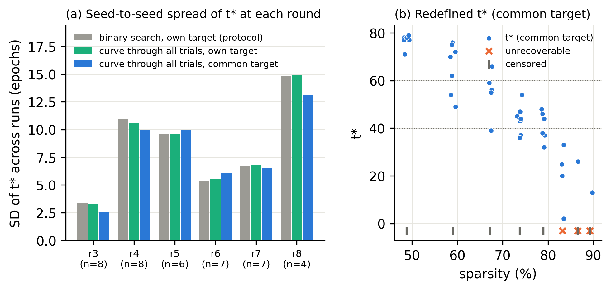
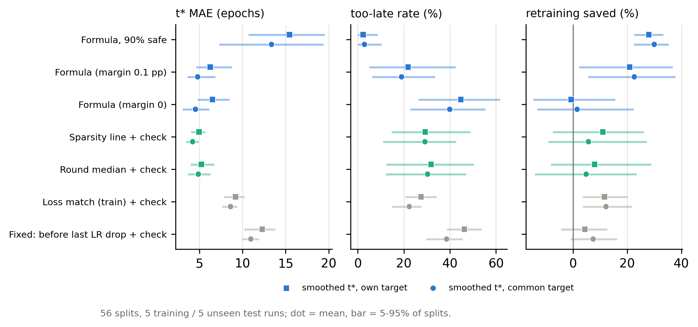
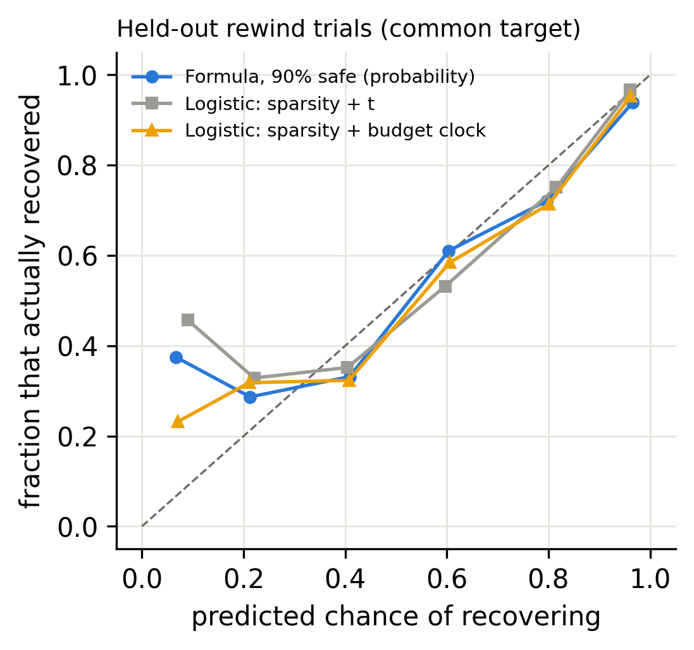

# Part 2: a steadier t*, and the comparison re-run

*Paths are relative to `imp_rewind/repeated_experiments/eval_10seed/`.*

This part follows on from [Part 1](01_ten_seed_evaluation.md). It uses the same 10 runs and the same 56 held-out splits (5 training runs and 5 unseen test runs), with no new training. The scripts are `07_redefine_tstar.py` and `08_reevaluate.py`, and the tables are `results/tstar_*.csv` and `results/reeval_*.csv`. I re-checked every headline number with separate code (scikit-learn isotonic regression and my own split loop), and they match.

## What was changed

1. **Common target.** The protocol's target is each run's own dense val accuracy − 0.5. Across the 10 runs, dense val accuracy is 91.00 ± 0.16 % (range 90.62–91.12). The common target is the mean, 91.004 − 0.5 = 90.504 %, and it is the same for every run.
2. **t\* from all trials of a round.** Instead of the binary search's single noisy retrains, a non-increasing curve (isotonic regression) is fitted through every rewind trial of the round, plus the unretrained pruned model at t = 80. t\* is the last epoch where that curve is at or above the target. This assumes nothing beyond "later rewinds don't recover better", which the binary search already assumes. A crossing is accepted only if the trials bracketing it are at most 10 epochs apart; otherwise the round is marked *censored*.

## Results for changes 1 and 2

| | protocol t\* | curve t\*, own target | curve t\*, common target |
|---|---|---|---|
| seed-to-seed SD of t\* at the same round (pooled over the same 40 rounds) | 8.54 epochs | 8.48 | 8.11 |
| mean distance from the round median | 5.65 | 5.65 | 5.32 |
| same spread, in e-folds of LR budget | 0.94 | 0.95 | 0.87 |
| link between a run's dense accuracy and how early its t\* is (Spearman, 9 runs) | +0.48 (p = 0.19) | +0.40 (p = 0.29) | −0.11 (p = 0.78) |

- **Fitting a curve through all trials barely changes t\*.** The mean change is 0.4 epochs, and 22 of 54 rounds changed at all. The binary search was not the main problem.
- **The common target removes the dense-accuracy effect.** Under each run's own target, runs with higher dense accuracy tend to get earlier t\*; that link disappears under the common target. The spread shrinks only about 5%, though.
- **What remains is small in accuracy terms.** 0.87 e-folds × κ (0.1025 pp per e-fold) ≈ 0.09 pp of recovered accuracy. That is smaller than the scatter of a single retrain around its round's curve (0.147 pp SD over 251 degrees of freedom). The run-to-run spread of t\* is therefore no larger than what retraining noise alone would produce. These data cannot separate real run-to-run differences from noise; replicate retrains (step 4) can.
- **Status changes under the common target.** 13 of 82 rounds change status:
  - 11 become censored, because the old search never tried epochs near the new crossing (4 in seed 9, 2 each in seed1_orig and seed 7, 1 each in seeds 4, 5 and 8);
  - seed 9 round 8 becomes unrecoverable;
  - seed 3 round 2 becomes no-retrain.
  
  Seed 8, whose run ended at 48.8% sparsity on a 0.04 pp miss of its own target, would have passed the common target at t = 2.

*Fig. 8. (a) Seed-to-seed spread of t\* at each round under the three definitions. (b) The redefined t\* (common target) against sparsity.*

## Change 3: the comparison re-run (Fig. 9)

**The "90% safe" formula.** This new rule picks the latest t whose predicted chance of recovering is at least 90%. The prediction error for a new run is estimated on the training runs only, by leave-one-run-out: σ ≈ 0.24 pp. That gives a margin of 1.28 σ ≈ 0.31 pp.

**Results under the common target.** These are means over 56 splits, with 5–95% ranges in brackets, over about 30.6 rounds with a t\* per split:

| method | t\* MAE (epochs) | too late | retraining saved vs t_min + check | false fallbacks to t_min per split |
|---|---|---|---|---|
| Formula, margin 0 | 4.54 [3.05, 6.13] | 39.9% | 1.5% | 0.0 |
| **Formula, margin 0.1 pp** | **4.80** [3.59, 6.85] | **19.0%** | **22.6%** | 0.5 |
| Formula, 90% safe | 13.36 [7.31, 19.38] | 2.9% | 30.0% | 4.2 |
| Sparsity line + check | **4.21** [3.43, 4.91] | 29.2% | 5.7% | – |
| Round median + check | 4.87 [3.64, 6.29] | 30.3% | 4.9% | – |
| Loss match (train) + check | 8.61 | 22.4% | 12.2% | – |
| Fixed: before last LR drop + check | 10.96 | 38.5% | 7.5% | – |
| t_min + check | 33.39 | 0% | 0% | – |

With only change 2 (curve, own target), the ranking is the same as in Part 1: formula (margin 0.1) 6.26 epochs, sparsity line + check 4.95.

*Fig. 9. The comparison re-run against the smoothed t\*, with each run's own target (squares) and the common target (circles).*

**Per-run paired comparison** (8 unseen runs; formula with margin 0.1 minus baseline, 95% bootstrap CI, Wilcoxon p):

| vs | MAE | too-late rate | retraining saved |
|---|---|---|---|
| Sparsity line + check | +0.57 [0.10, 1.15], p = 0.078 | −9.3 pp [−13.9, −4.8], p = 0.031 | +16.7 pp [12.6, 21.3], p = 0.016 |
| Round median + check | −0.01 [−0.71, 0.60], p = 0.94 | −9.7 pp [−17.1, −3.2], p = 0.062 | +16.6 pp [7.9, 25.6], p = 0.031 |
| Loss match (train) + check | −3.45 [−5.33, −1.43], p = 0.031 | −3.4 pp, n.s. | +12.0 pp, p = 0.16 |

**Equal-safety comparison** (common target; `reeval_tradeoff_sweep_pop.csv`):

- **Accuracy.** At the same too-late rate (about 29%), the formula (margin 0.05) has MAE 4.29 and the sparsity line has 4.21, which is effectively a tie.
- **Retraining saved, recoverable rounds only:**

| too-late rate | formula | sparsity line + check | round median + check |
|---|---|---|---|
| about 20% | 33.2% | 29.4% | 30.1% |
| about 13% | 37.1% | 37.0% (at 14.7%) | — |
| at or below 10% | 37.6% (at 9.3%) | 41.4% (at 8.5%) | — |

  The formula's larger overall saving comes mainly from falling back to t_min on rounds that cannot recover. It flags 2.1 of the 3.75 such rounds per split, with 0.5 false flags.

**Calibration of the 90%-safe formula on held-out trials (Fig. 10).** Of the held-out rewind trials it rated at least 90% likely to recover (about 42 per split), 95.2% did, so the promise holds. Its probabilities are not better than a plain logistic regression fitted on the same training runs:

| model | Brier score |
|---|---|
| formula, 90% safe | 0.183 |
| logistic regression, sparsity + budget clock | 0.174 |
| logistic regression, sparsity + t | 0.177 |
| constant rate | 0.241 |

The difference between the formula and the budget-clock logistic regression is +0.0075 [0.0013, 0.0134], p = 0.055. The budget-clock version is slightly better than the one using raw t.

*Fig. 10. Predicted chance of recovering against the fraction of held-out rewind trials that actually recovered (common target).*

## What this means

**Confirmed**

- t\* as the protocol defines it carries noise from the dense reference run. A common target removes that, and it is the right definition going forward.
- Under the common target, the formula is as accurate as the best simple baseline. It ties the round median and is within 0.6 epochs of the sparsity line, a tie at equal safety.
- It is also safer than the simple baselines (about 10 points fewer too-late guesses, on every run that differed) and saves more retraining overall, because it recognises rounds that cannot recover.

**Not confirmed**

- The formula is not more accurate than the simple baselines at predicting t\*.
- On recoverable rounds it saves no more than a sparsity line shifted to the same safety level.
- Its recovery probabilities are well calibrated at the top, but no better than logistic regression.

**Open**

- Whether the leftover run-to-run spread in t\* (equivalent to about 0.09 pp of accuracy) is real or retraining noise. The replicate experiment (step 4) answers this.

## Limitations

- 11 rounds (13%) could not be scored under the common target because the original searches were aimed at each run's own target. These are concentrated in seed 9, the run with the lowest dense accuracy. All methods are scored on the same rounds, but these are the rounds where the target moved most.
- The IMP chains themselves were run under the old targets. Re-scoring cannot show how a chain would have continued under the common target.
- Everything is still 8 unseen runs on one validation set, so p-values near 0.05 are weak evidence.

Figures 8–10 are in [`figures/`](../figures) as PNG and PDF.
